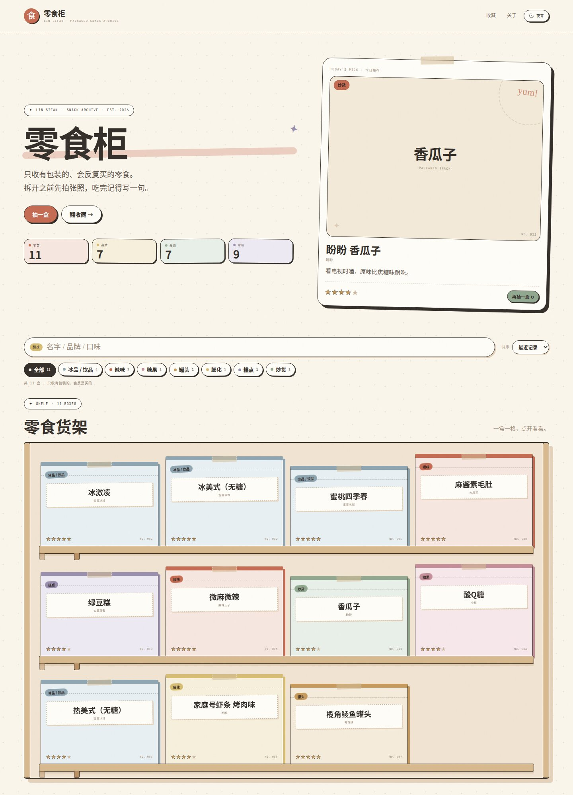
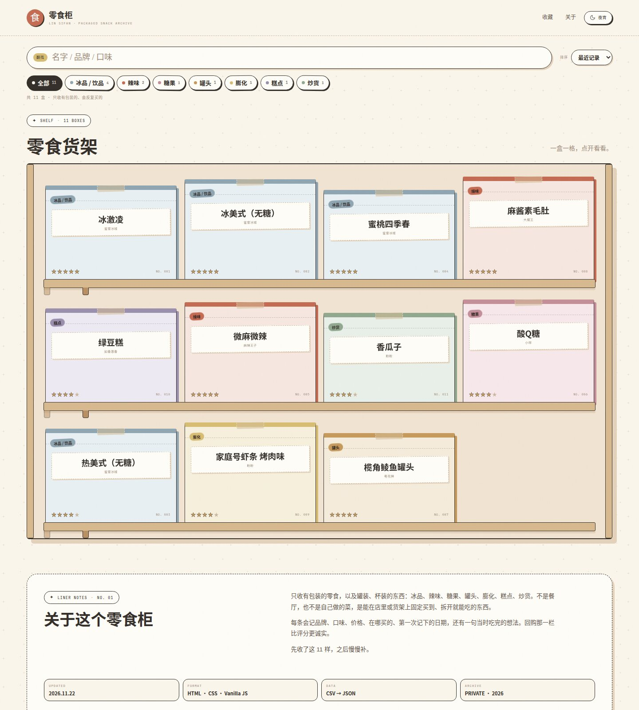
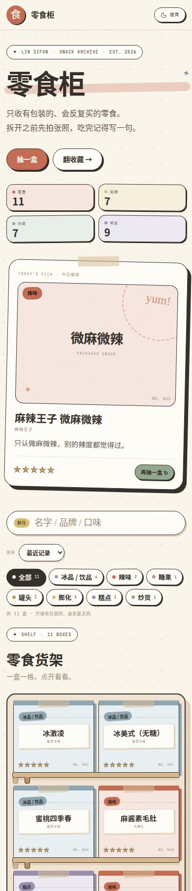
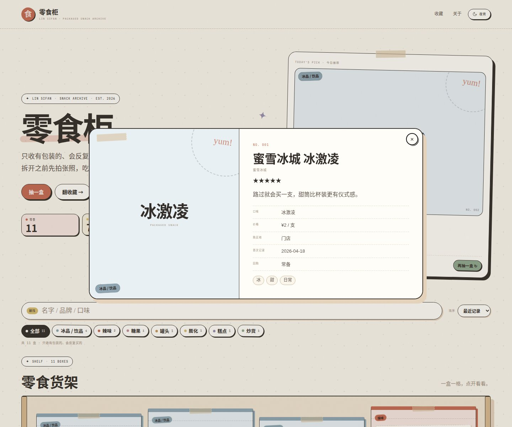
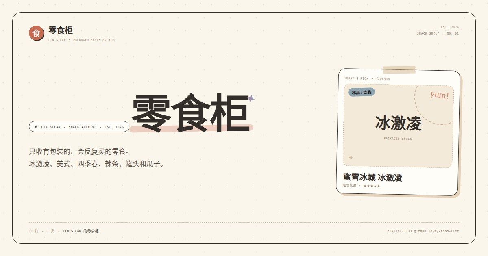

# 零食柜

> Lin Sifan 的包装零食档案 · 只收有包装的、会反复买的零食。


**在线访问：<https://tuxlin123233.github.io/my-food-list/>**

<p align="center">
  
</p>

## 关于

一个只收集**有包装零食**的个人档案：冰品和饮品、辣味、糖果、罐头、膨化、糕点、炒货。不收录餐厅，也不收录自己做的菜。

目前收了 11 样：

- 蜜雪冰城 冰激凌
- 蜜雪冰城 冰美式（无糖）
- 蜜雪冰城 热美式（无糖）
- 蜜雪冰城 蜜桃四季春
- 麻辣王子 · 微麻微辣
- 小样酸Q糖
- 粤花牌榄角鲮鱼罐头
- 大魔王麻酱素毛肚
- 盼盼家庭号虾条 · 烤肉味
- 如香惠香绿豆糕
- 盼盼香瓜子

每条记录包含品牌、口味、价格、购买地、首次记录的日期，以及一句当时吃完的想法。回购那一栏比评分更诚实。

## 功能

- 11 样零食，7 个分类
- 搜索名字 / 品牌 / 口味 / 笔记
- 分类筛选、按最近记录 / 评分 / 名字 / 分类排序
- 「抽一盒」随机推荐，今日推荐卡片可点开详情
- 货架式布局：一盒一格、分层摆放，点盒子开详情
- 滚动时盒子随位置轻微仰俯，像在货架前慢慢走过
- 奶油底、低饱和贴纸盒子：纸胶带、硬边影子、分类小色标、评分与回购印章
- 纯文字标签卡，不使用图标
- 白天 / 夜宵两套主题，自动记住选择
- 手机端适配，详情弹窗
- 页脚显示最后更新日期

## 界面预览

<p align="center">
  
  
</p>

<p align="center">
  
</p>

<p align="center">
  
</p>

## 数据与更新

数据源是 `data/snacks.csv`，构建脚本会生成 `js/data.js`。

```bash
python3 tools/build_site_data.py
```

CSV 字段：

| 字段 | 说明 |
| --- | --- |
| `id` | 编号，比如 `001` |
| `name` | 零食名 |
| `brand` | 品牌 |
| `category` | 分类：冰品 / 饮品、辣味、糖果、罐头、膨化、糕点、炒货 |
| `flavor` | 口味 |
| `rating` | 1–5 分 |
| `repurchase` | 常备 / 会回购 / 偶尔 / 囤过 |
| `price` | 价格，比如 `¥8.5 / 70g` |
| `place` | 购买地 |
| `date` | 首次记录日期 `YYYY-MM-DD` |
| `tags` | 标签，用 `\|` 分隔 |
| `note` | 一句吃后感 |

新增分类时，把分类名加进 `tools/build_site_data.py` 的 `CATEGORY_ORDER`，并在 `css/style.css` 的分类色里补一条。

## 本地预览

```bash
python3 -m http.server 8000
```

然后打开 <http://localhost:8000>。

## 技术栈

- 原生 HTML / CSS / JavaScript，无框架、无构建依赖
- 卡片使用纯色块与文字标签，不依赖图标或外部图片
- 数据：CSV → JSON（`tools/build_site_data.py`）
- 部署：GitHub Pages

## 说明

价格和购买地会随时间和门店变化，仅作记录。
